  <a href="https://www.linkedin.com/in/adem-derbali-3519a9339/">LinkedIn</a> &nbsp;·&nbsp;
  <a href="https://3-d-portfolio-jade-three.vercel.app">Portfolio</a> &nbsp;·&nbsp;
  <a href="mailto:adamderbali16@gmail.com">Email</a> &nbsp;·&nbsp;
  <a href="./CV.pdf">CV (PDF)</a>

## About

Final-year Software Engineering & Information Systems student at ISIMA (Institut Supérieur d'Informatique de Mahdia), graduating in 2026.
I build web and mobile apps end to end: data model, API, interface. Lately I've also been integrating LLMs into applications (API integration, prompt engineering, RAG).

I'm looking for an **end-of-studies (PFE) internship** in full-stack development or software engineering.

## Stack

## Selected work

| Project | What it is | Built with |
|:--|:--|:--|
| [**CalKoul**](https://github.com/DerbaliAdem/CalKoul) | Nutrition mobile app for Tunisian food: food search, nutrition facts, portions, meal tracking and daily calorie and macro totals. | React Native · Expo · TypeScript · USDA FoodData Central API |
| [**UniManage**](https://github.com/DerbaliAdem/UniManage) | University management platform: room scheduling, attendance, academic management and AI-powered recommendations. | Java · Spring Boot · PostgreSQL · TypeScript |
| [**ClinicHub**](https://github.com/DerbaliAdem/clinichub) | Clinic management system for patients, doctors, appointments and users, with a relational PostgreSQL schema behind a REST API. | React · Vite · Tailwind CSS · NestJS · PostgreSQL |
| [**CVScore**](https://github.com/DerbaliAdem/CVScore) | Scores CVs against a job description using TF-IDF and cosine similarity, with PDF text extraction. | Java · Spring Boot · Spring Data JPA · PostgreSQL · PDFBox · React |
| [**3D Portfolio**](https://github.com/DerbaliAdem/3D_portfolio) | My personal site, presenting my projects and skills through an interactive 3D scene. [Live →](https://3-d-portfolio-jade-three.vercel.app) | React · Three.js · React Three Fiber · Tailwind CSS · Framer Motion |

## Currently

- Deepening backend architecture with NestJS and Spring Boot
- Learning Docker and JWT authentication
- Building more AI features into real applications

## Education

**Licence in Computer Science — Software Engineering & Information Systems**
ISIMA, Mahdia, Tunisia · 2026

## Languages

Arabic (native) · English (B2) · French (B1) · German (A2)

## Contact

Open to internship offers and collaborations. Reach me by [email](mailto:adamderbali16@gmail.com) or on [LinkedIn](https://www.linkedin.com/in/adem-derbali-3519a9339/).
